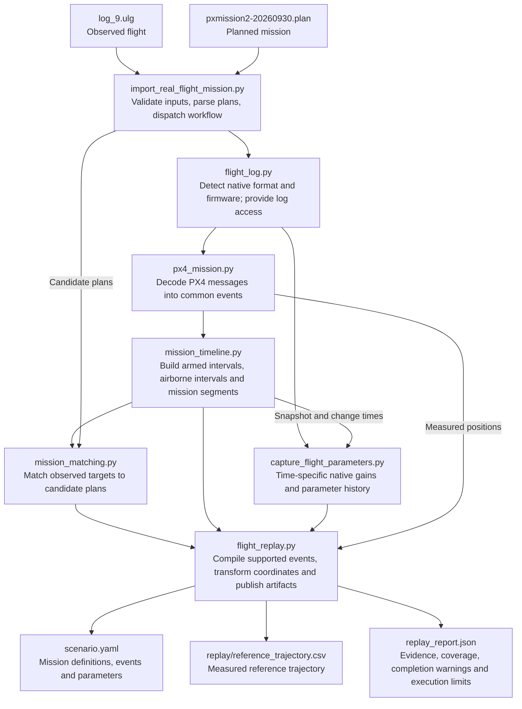
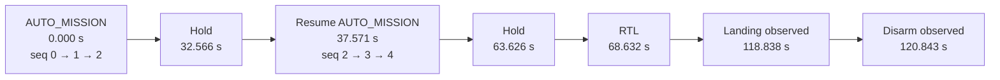
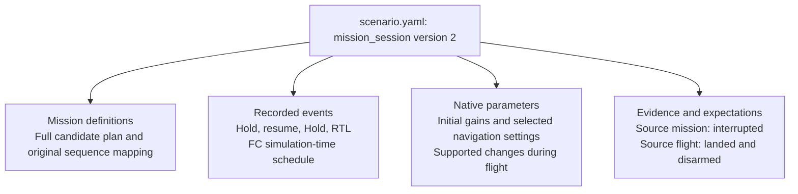
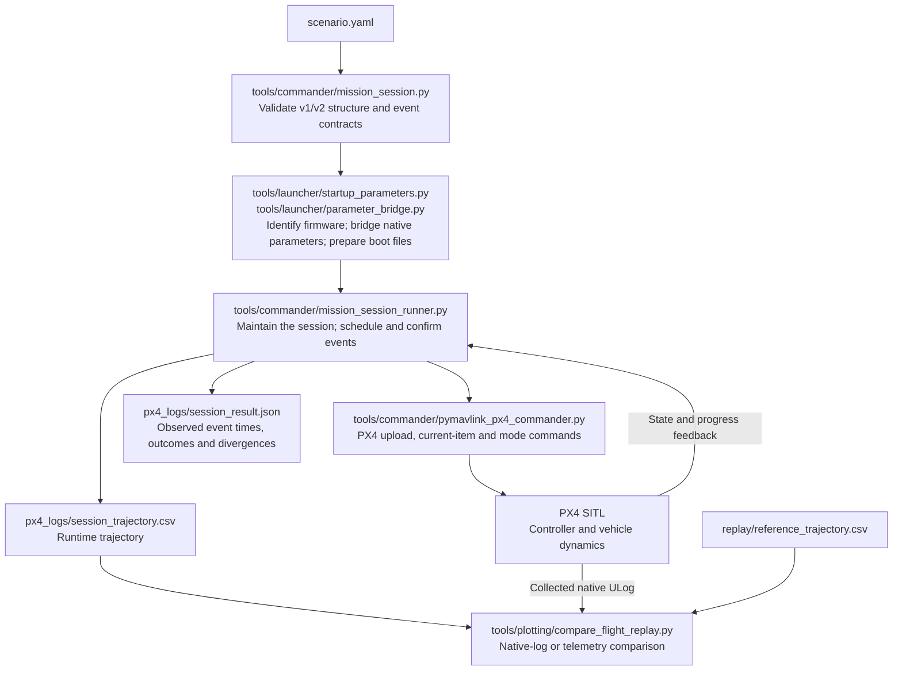

# Flight-log-driven scenario conversion

This document describes the timeline import architecture and its application to
`log_9_2026-9-30-11-01-36.ulg` and `pxmission2-20260930.plan`.
The source flight is supplied with `--flight-log`; one or more candidate mission
definitions are supplied with `--plan` (renamed from `--input`).
All log-based imports use one timeline pipeline. The `--replay-mode` option and
legacy complete-only matching path have been removed; remove that option from
older commands. Completed and interrupted missions use the same parameter
capture, startup procedure and runner. `--analyze-only` reports evidence without
requiring an executable scenario.

Equivalent replay means using the same mission targets, captured parameters and
recorded interventions. It does **not** prescribe the measured trajectory. The
simulated vehicle generates its own trajectory, which is compared with the
reference without fitting coordinates or warping time.

## From native log to scenario

Files in this diagram are under `tools/scenario/`.



For an ArduPilot BIN, `ardupilot_mission.py` replaces `px4_mission.py`. The common
analysis, matching and compilation layers are shared. File magic selects the
decoder; changing a filename extension does not convert its contents.

| File | Responsibility |
| --- | --- |
| `import_real_flight_mission.py` | CLI, plan validation and workflow dispatch. |
| `flight_log.py` | Format-safe access, hashes, firmware identity and analysis entry point. |
| `px4_mission.py` | PX4 state, home, mission-result, navigator and position-setpoint evidence. |
| `ardupilot_mission.py` | ARM/MODE, stored CMD snapshots, MISE command starts and landing evidence. |
| `mission_timeline.py` | Distinct armed intervals, airborne intervals, mode segments, revision boundaries and sequence rewinds. |
| `mission_matching.py` | Candidate matching, observed coverage, ambiguity and unused plans. |
| `capture_flight_parameters.py` | Existing time snapshots and complete parameter-change history. |
| `flight_replay.py` | Replay capability checks, events, native parameter snapshots, shared coordinate transform and atomic publication. |

Analysis does not require completion. A missing end, manual interval, unmatched
mission or ambiguous plan remains visible in the audit. Compilation is stricter:
it must have enough evidence to execute the selected flight. Use `--flight-id`
to explicitly select one or more analyzed armed intervals.

## Ground-start replay windows within an armed interval

`flight_000` still identifies an arm-to-disarm interval. Analysis retains its
complete mode history and every airborne interval. For generation, the replay
window begins at its first observed MISSION segment and ends at the recorded
disarm. Earlier non-mission flying may be excluded only if native evidence
confirms that the vehicle returned to the ground before mission entry. The
selected window must contain exactly one takeoff and a confirmed landing before
disarm. Without explicit mission-segment selection, midair starts, repeated takeoffs after mission entry and manual control
inside the selected window still fail. An earlier MISSION segment without item
observations also fails rather than being discarded as non-mission flying.
HOLD, resume, RTL and supported mission
changes remain part of the replay; this is not an AUTO-only mode filter.

ArduPilot airborne/landed transitions use `EV 28` (`NOT_LANDED`) and `EV 18`
(`LAND_COMPLETE`). `POS.RelHomeAlt` is used for the reference trajectory, never
as a takeoff detector. Missing native state evidence is not replaced by a height
threshold. A positive height above home cannot undo a native landing event.
Each mission's terminal LAND is linked to its own airborne interval, so a later
flight cannot supply or invalidate its completion evidence.

ArduPilot also sets its landed flag in the disarm routine. An `EV 18` immediately
after disarm therefore does **not** certify a preceding touchdown. The analysis
retains the first native landing event within 10 ms in `post_disarm_land_events`,
provided no rearm or intervening land-state event occurs. This bound only
associates neighboring log writes; it does not change timestamps, close an open
airborne interval or upgrade `disarmed_landing_unconfirmed`. The recorded state
can still establish the initial landed state of the next arm interval.

The audit and each generated phase contain `replay_window`: source start/end,
original arm time, ground evidence, selected airborne intervals, excluded prefix
bounds (exclusive end), and any window-selection issues. Analysis still runs the
full matching process, and generation performs additional capability checks.
`analysis.flights` retains all original segments; phase `timeline_segments`
contains only the selected tail. A `pre_mission_flight_excluded` warning is
emitted if the prefix contains a flight. The original arm timestamp remains
unchanged; the prefix's manual inputs, flight duration and internal controller
state are not replayed. Inter-phase `ground_wait_s` retains its existing recorded
disarm-to-arm meaning, not the duration of an excluded airborne prefix.

For `00000006.BIN` with `1.plan`, the selected window is **284.591462–362.331418 s**
on the source boot clock. The earlier GUIDED/POSHOLD/ACRO portion and its flight
remain in the audit. Native takeoff is at 285.203777 s and landing at 361.826284 s.
The mission is classified as completed. Gains and flight settings are captured
at `time:284.591462`; supported changes and reference trajectory samples are
bounded by the same window. `flight_001` has no observed mission and is excluded.
Its post-disarm landing reset is preserved without certifying a touchdown.

The existing runner supports this selected ground-to-disarm mission. Replaying
multiple takeoffs while continuously armed would additionally require runner
support for armed ground transitions and is not enabled by this crop policy.

## Matching, source outcome and replay capability

These are independent decisions:

| Decision | Meaning | Generation policy |
| --- | --- | --- |
| Plan matching | Which candidate agrees with the observed commands and targets? | Require an unambiguous match for each selected execution. |
| Source mission outcome | Did the source mission complete, get interrupted, or lack completion evidence? | Incomplete/unknown outcomes produce warnings, not automatic rejection. |
| Replay capability | Can the initial state, interventions and ending be represented by the runner? | Require a supported initial state and executable ending. |

A Hold followed by a resume and final plan LAND belongs to one execution. It is
completed if completion is confirmed. Replacements and observed sequence rewinds
start separate entries in `mission_executions`, so a later completion does not
hide an earlier interrupted attempt. The phase-level `source_mission_outcome`
describes the last execution; `mission_executions` retains every attempt.

For PX4, completion requires a fresh valid finished result after the final
canonical plan LAND and observed subsequent landing. For ArduPilot, the final
MISE LAND selection and subsequent landing provide completion evidence. Merely
selecting an item is not equivalent to reaching it. Observed sequence coverage
is reported independently: a firmware completion indication does not verify the
contents of unobserved plan items.

A final plan LAND with observed landing/disarm but no fresh PX4 finished flag is
`unknown`, not falsely certified as completed. It can still be replayed with a
warning because its ending is known. Conversely, a log ending in midair does not
provide a supported ending; it remains available through `--analyze-only` but
requires a future partial-window/cleanup policy before generation.

Warnings are printed to **stderr** (keeping `--dry-run` JSON on stdout valid) and
stored in `mission_session.warnings`, `replay_report.json` and `import_report.json`.
Phase warnings identify the flight, mission attempt, observed sequences and last
reached item when available. Codes include `mission_interrupted`,
`mission_completion_unknown`, `mission_failure_recorded` and `unused_plan`.
A native failure flag is reported as a warning when matching, initial state and
terminal actions are supported. Its cause is not injected into SITL. Invalid
mission contents (`valid=false`) still prevent generation.

Full completion is no longer a generation requirement. If a study needs only
completed flights, select them from the analysis with `--flight-id`; there is no
separate completion-only runner or parameter-capture path. Missing home/state,
unsupported manual control, ambiguous plans, invalid mission evidence and missing
landing/disarm remain generation errors, separately from completion warnings.

## What log_9 actually contains

Time zero is the first armed AUTO_MISSION transition, at boot time
89.721932 seconds. The arm event precedes this by about 2.973 seconds.



The observed targets at indices 0 through 4 match the supplied plan. The last
reported reached item is 3; item 4 is active when the mission is interrupted.
The full input plan has indices 0 through 9, but its unobserved suffix is not
verified by this log. Both AUTO segments belong to the same recorded revision.

A PX4 navigator work item is not necessarily an uploaded mission item. Internal
climb and landing work items must be distinguished from canonical targets.
In particular, RTL's internal landing sequence is **not** evidence that the
plan's final item 9 was executed. ArduPilot MISE similarly indicates command
start, not necessarily arrival or completion.

The native log contains battery warnings and RC-loss evidence. This replay
reproduces mode effects. It does not inject RC loss or reproduce a battery model.
Failure-cause reproduction is a separate experiment.

## Scenario contents and execution policy



By default, one phase represents a replayable ground-to-ground armed interval;
its timeline segments are not separate arm/disarm cycles. Hold does not end the
phase or reset gains. Switching to RTL does not require reaching the plan's last
item. The phase ends only after actual landing and disarm, not at the recorded
landing timestamp.

Events use the simulated flight-controller clock. The runtime anchor is the
latest position clock immediately before the MISSION request. The first armed
MISSION heartbeat confirms that startup succeeded. Native
ULog comparison independently aligns the first armed AUTO_MISSION transition;
the request and native transition anchors may differ by telemetry latency, which is reported.

The vehicle executes mission navigation normally. External mode changes are
scheduled at their recorded elapsed times. A resume preserves the SITL mission
cursor. Its observed cursor is compared with the source expectation, and any
difference is reported; it is not silently corrected with a waypoint jump.
Explicit sequence-rewind events, by contrast, request and confirm a new cursor.

A mission replacement requests Hold, confirms it, uploads the new definition,
sets and confirms its starting cursor, and returns to MISSION. This introduces
an explicit upload/hold transition that can differ from the original firmware's
in-flight upload timing. The result records confirmation times and mappings.

The current compiler requires a confirmed initial TAKEOFF from item zero, one
airborne interval, and eventual landing/disarm. It rejects manual/offboard
segments, missing initial state, changing home or incomplete evidence. These
remain analyzable. For example, log_11 is identified as a resumed mission but
cannot be compiled without a separate policy for its manual takeoff/setup.
No undocumented initial-state teleport or reconstructed pilot input is used.

| Case | Analysis | Replay |
| --- | --- | --- |
| One complete mission | Supported | Supported |
| One mission interrupted by Hold/RTL/LAND | Supported | Supported when initial takeoff and eventual landing are confirmed |
| Hold and repeated resume in one flight | Supported | Supported with continuous vehicle state |
| Explicit mission sequence rewind | Recorded separately | Current-item command, with confirmation |
| Different observed mission revisions in one flight | Separate matching groups | Replacement definitions and confirmed upload transition |
| Multiple flights in one log | Separate armed intervals | Supported; each phase has its own time origin |
| Shared-prefix candidate plans | Ambiguous unless later evidence resolves them | Rejected while ambiguous |
| Manual setup or log beginning midair | Preserved in audit | Explicit PX4 mission-segment comparison can prepare observed state; manual input replay remains unsupported |
| Missing landing/disarm, dropouts, unconfirmed targets | Preserved in audit | Rejected rather than classified as complete |

Plan candidates need not all occur in the log. Unused plans produce warnings.
Repeated uploads with unchanged content are not automatically a new mission.
A changed PX4 revision identifier is evidence to examine, not proof that a
particular external plan was uploaded. Unknown or inconsistent content is not
forced into a candidate match. Separate logs retain independent boot clocks;
there is no automatic cross-file flight concatenation.

## Common runner and firmware adapters



ArduPilot uses `pymavlink_ardupilot_commander.py` with the same session runner.
Firmware name/unit conversion remains in the execution bridge. The generator
preserves native source values. Initial parameters are applied and read back
before flight; supported REAL32 changes are applied and checked at event times.

For PX4, the allowlist includes horizontal/vertical speed, acceleration/jerk,
takeoff/landing speed, waypoint acceptance, RTL altitude/descent/delay and land
disarm delay. It does not copy arbitrary hardware, calibration, estimator or
failsafe-disable parameters. Every allowlisted setting is required for PX4 log
replay, together with `MPC_XY_CRUISE`. ArduPilot log replay requires the native
speed name selected by its source schema (`WPNAV_SPEED` or `WP_SPD`). Required
gains and flight settings use the same mission-start snapshot. Missing values
raise an error naming the flight, cutoff and parameters; later observations,
plan metadata and firmware defaults are never used as replacements.
Airframe, wind, estimator state and unlisted defaults can still differ. This
requirement covers the supported replay parameter set, not every firmware parameter.

With `--flight-log`, controller gains always come from the log at each mission
start, and supported gain changes are replayed. `--controller-gain-profile` is
an optional plan-only setting and cannot be combined with `--flight-log`.
Omitting the profile in plan-only conversion keeps firmware gain defaults;
omitting required gains in a log causes an error.

The importer does not accept `--speed-m-s` or `--use-firmware-speed`. Recorded
speed changes are always replayed, and mission CHANGE_SPEED commands remain in
sequence. Plan-only conversion uses `mission.hoverSpeed` automatically and rejects
missing or invalid values. Speed experiments belong in `scenario_generator.py`;
that generator is unchanged by this importer update.

All mission and reference horizontal coordinates use one actual-home N/E origin
translated to Purdue. Heights remain relative to each flight's home. There is
no fitted translation, rotation, scale, or time warp.

`source_mission_outcome=interrupted` and `replay_outcome=completed` can both be
correct: successful reproduction of an interrupted flight does not mean that
the original mission was completed.

## Reproduce the log_9 experiment

From the repository root:

```bash
python3 -m tools.scenario.import_real_flight_mission \
  --flight-log ../FIRE_moonshot_classifier/data/flight_test/260930_flight_logs/log_9_2026-9-30-11-01-36.ulg \
  --plan ../FIRE_moonshot_classifier/data/flight_test/260930_flight_logs/pxmission2-20260930.plan \
  --outdir data/replays_260930/log9

python3 -m tools.launcher.run_px4_gz_sitl \
  --run-root data/replays_260930/log9 \
  --headless --max-run-s 360 --max-retries 0

python3 -m tools.plotting.compare_flight_replay \
  --run-dir data/replays_260930/log9 --sitl-source ulog
```

Use a new output directory when importing again. Add `--analyze-only` to inspect
all intervals without writing a scenario. No replay-mode option is needed.
`log_9` generates a `mission_interrupted` warning and the recorded four-event
scenario; it is not rejected for failing to finish the supplied plan.

Comparison writes `state_comparison.png/svg`: a 2-by-3 panel per phase containing
horizontal path, Real/SITL altitude above home, 3D position difference,
horizontal speed, vertical velocity (up positive), and 3D speed. Position errors
and metrics use overlapping source times only. The 3D path and planned waypoints
are always generated. The old separate `trajectory_comparison` and `speed_comparison`
figures are no longer generated and are removed when reusing the output folder.

PX4 velocity uses the logged NED estimates in `vehicle_local_position.vx/vy/vz`,
with vertical up equal to `-vz`. ArduPilot uses the native PSC velocity fields.
There is no position differentiation or smoothing. Both real and SITL native logs
are required, even for the telemetry position source. Velocity source hashes,
fields and comparison bounds are recorded in `metrics.json`; velocity and speed
CSVs contain the plotted data. Selected mission segments exclude setup and
cleanup from both position and velocity comparison.

The comparison also always writes `command_comparison.png/svg` (native motor
commands; PX4 normalized thrust preferred) and `mission_timeline.png/svg`
(observed mode and native mission-item number, as step plots). Current item
numbers may remain unchanged during HOLD/RTL and include non-waypoint commands.
Missing optional command/progress topics are marked unavailable. All figures
share phase time origins and bounds; the former `--details` flag is removed.


## Unified importer validation

After removing the separate replay modes, the related scenario, commander,
launcher and plotting suite passed **298 tests**. Coverage includes shared
parameter capture for completed/interrupted flights, time-specific gain changes,
recorded cruise-speed changes, completion warnings on stderr with valid JSON on stdout,
Hold/resume completion, replacements/restarts retaining earlier interruptions,
unknown completion, native failure flags versus invalid mission data, and
continued support for existing session files.

Offline validation with the original source files confirmed:

- `log_9`: one interrupted flight, one completion warning, and the four recorded
  Hold/resume/Hold/RTL events, using the default import command.
- `00000007.BIN`: three completed flights (`2.plan`, `2.plan`, `3.plan`), no
  completion warnings, and version-2 sessions using the same timeline path.
- The log_9 mission definitions, scheduled events, gains, flight parameters,
  initial time, timeout and ground wait equal the inputs of the previous SITL
  experiment below. SITL was not rerun for the importer unification.

```bash
PYTEST_DISABLE_PLUGIN_AUTOLOAD=1 PYTHONPATH=. python3 -m pytest \
  --import-mode=importlib \
  tests/tools/scenario tests/tools/commander tests/tools/launcher tests/tools/plotting \
  -q --tb=short
```

## Strict parameter-source validation

The subsequent removal of importer speed overrides passed **306 tests** across
the scenario, commander, launcher and plotting suites. Tests now require native
speed/navigation/RTL values at the mission-start cutoff, reject missing or
late-first-observed settings without plan/default substitution, reject invalid
settings, and preserve both recorded parameter changes and mission CHANGE_SPEED
commands. Plan-only imports automatically use a valid `mission.hoverSpeed`.

Offline checks with the original files confirmed all 18 required PX4 flight
settings for log_9, including `MPC_XY_CRUISE=5 m/s`, and the three ArduPilot flights
in `00000007.BIN` with native `WP_SPD=10 m/s`. These checks generated dry-run
sessions; SITL was not rerun for this parameter-policy update.
`scenario_generator.py` was not modified.

## Validation and measured comparison

Before the importer unification, the timeline runner was exercised with the original
log_9 and local PX4 SITL. The measurements below describe that recorded experiment.
The final run completed landing and disarm. It applied and verified **38 native
parameters** (20 controller gains and 18 flight settings). All four scheduled
mode events were confirmed. Command scheduling lag was 0.029–0.070 simulated
seconds; heartbeat confirmation followed later. The request-time anchor was
0.019 seconds before the native AUTO_MISSION transition.

| Quantity | Result |
| --- | --- |
| Source mission outcome | Interrupted |
| Source/replayed flight outcome | Landed and disarmed |
| Real mission start to disarm | 120.843 s |
| SITL mission start to disarm | 122.340 s |
| Horizontal position RMSE, overlapping time only | 18.478 m |
| Vertical position RMSE | 2.016 m |
| 3D position RMSE | 18.587 m |
| Maximum 3D position error | 38.010 m |

At the resume event, the original mission was on item 2 while SITL was still on
item 1. At the recorded RTL event, SITL was on item 3 while the source was moving
to item 4. This progression difference is retained, not hidden by forced jumps.
The experiment confirms event replay, not equality of controller/vehicle response.

The automated suite for that experiment passed **287 tests**. It includes partial matching,
shared-prefix ambiguity, repeated flights, revision replacement, mode/current-item
confirmation, dynamic parameter validation and native ULog alignment. The existing
ArduPilot `00000007.BIN` analysis still identifies `2.plan`, `2.plan`, `3.plan` as
three completed executions. Midair replacement has synthetic and runner tests;
the end-to-end real-log experiment here exercises Hold/resume/RTL.

Archived artifacts are under `data/replays_260930/log9_timeline/`. These saved
experiment plots predate the combined `state_comparison` figure and native
velocity plots described above:

- [Generated scenario](../data/replays_260930/log9_timeline/scenario.yaml)
- [Validation report](../data/replays_260930/log9_timeline/validation_report.json)
- [Runtime result](../data/replays_260930/log9_timeline/px4_logs/session_result.json)
- [Metrics and source hashes](../data/replays_260930/log9_timeline/comparison/metrics.json)
- [3D trajectory and planned waypoints](../data/replays_260930/log9_timeline/comparison/trajectory_3d.png)
- [Position-derived speed comparison](../data/replays_260930/log9_timeline/comparison/speed_comparison.png)
- [Horizontal path, altitude and position error](../data/replays_260930/log9_timeline/comparison/trajectory_comparison.png)

Generated `data/` artifacts are local experiment outputs, separate from the source
code and this document. Earlier attempts are retained by the launcher's archive.

## Explicit automatic mission segment comparison

`--mission-segment FLIGHT_ID:SEGMENT_ID` selects one PX4 MISSION segment from
`--analyze-only`. It is mutually exclusive with `--flight-id`. The original
full-flight audit remains in the replay report, including unmatched attempts
and manual intervals outside the selected window. This option does not make
manual input replay available.

For log_11, `flight_000:segment_007` selects boot time
111.896897–149.030146 s (37.133249 s), starting at source sequence 4. Internal
PX4 climb work is included. The complete plan is uploaded so later waypoints
remain available to the navigator; waypoint timing is not forced to match the
recording.

At an in-air start the importer uses the latest valid samples at or before the
start, with a maximum age of 250 ms. Position, NED velocity, heading, attitude
quaternion and body angular rates are recorded. The target position is relative
to the actual flight home and translated to the existing SITL origin.
`MIS_TAKEOFF_ALT` is captured in addition to the usual replay flight settings.
The reference CSV is restricted to the half-open selected window and requires
samples near both boundaries, with no gaps longer than one second.

The runner boots and arms normally, streams OFFBOARD position/velocity/yaw
setpoints, settles at a lead-in point, then approaches the requested state.
Default matching tolerances are 0.5 m position, 0.3 m/s velocity and 5 degrees
yaw. The lead-in settles for one second; setup times out after 120 seconds.
Initial states below 0.5 m above home are unsupported by this setup policy.
The runner confirms the selected mission item before handoff. Attitude and
angular rates are audited but not imposed. Failure to meet the matching
conditions fails the run rather than silently starting at another state.

Every generated `import_report.json.phases[]` discloses `start_condition`
(`on_ground` or `in_air`). In-air entries contain the source sample timestamps,
target state, setup policy/tolerances, and `internal_state_restored: false`.
Controller integrators, filters, prior setpoints, estimator biases and covariance
are not restored. The setup flight creates its own internal state. Initial
transients therefore need not equal those in the source flight.
`px4_logs/session_result.json.phases[].initialization` records the measured
state and position/velocity/yaw errors at handoff readiness.

After a complete window following MISSION confirmation, the runner commands
LAND and waits for landing/disarm. The small confirmation margin and landing
are cleanup, outside the scored interval. Native ULog comparison locates the
selected MISSION transition, verifies its initial source sequence and continued
MISSION operation, and clips to exactly the source duration. Early mode exit,
incomplete trajectory coverage and a wrong initial sequence are rejected.
Telemetry comparison uses the request-clock approximation and is cropped to
the same nominal duration.

Validation with log_11 completed setup, sequence-4 mission execution and landing
in local PX4/Gazebo. Setup errors were approximately 0.403 m position,
0.055 m/s velocity and 0.58 degrees yaw. Native comparison covered only the
selected 37.133249 s window. This validates the execution path, not equivalence
of the real and simulated airframes or hidden controller states.
